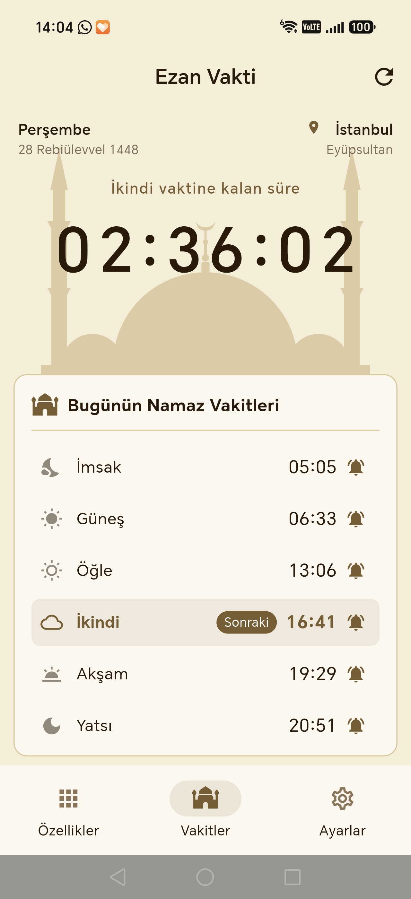
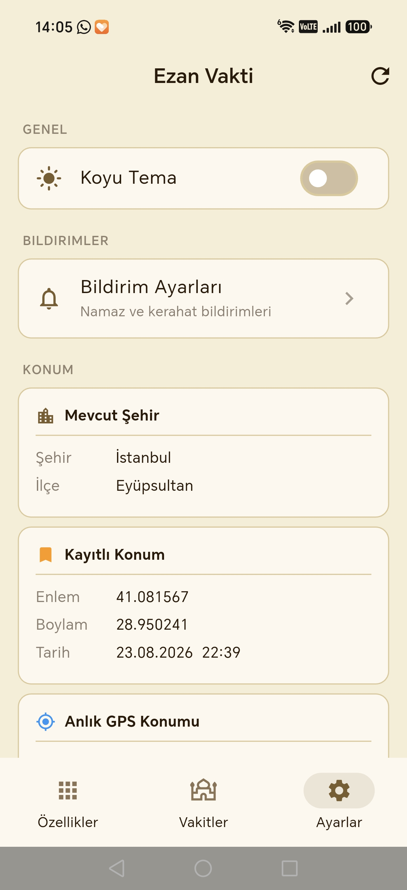
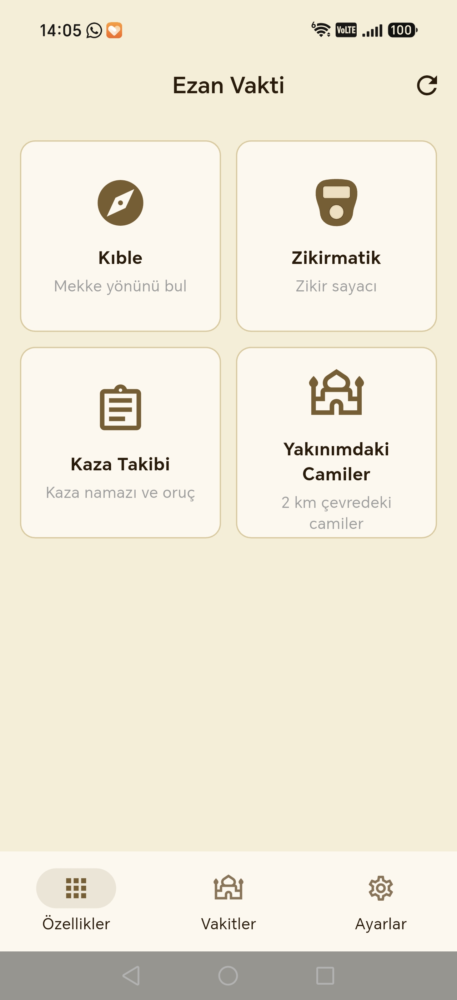
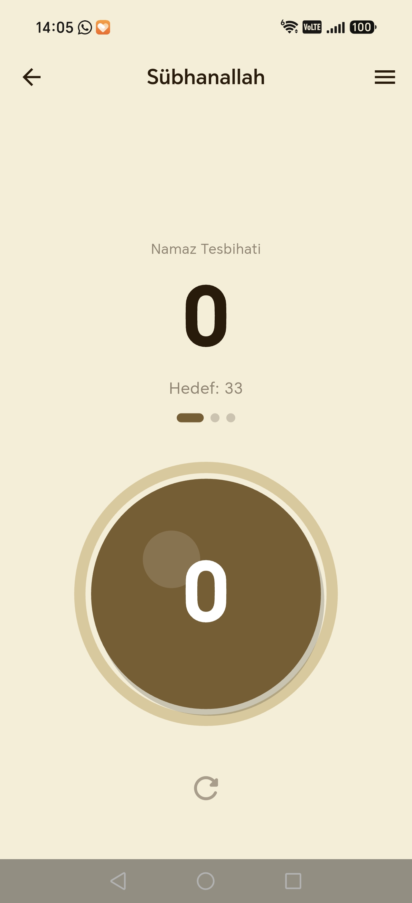
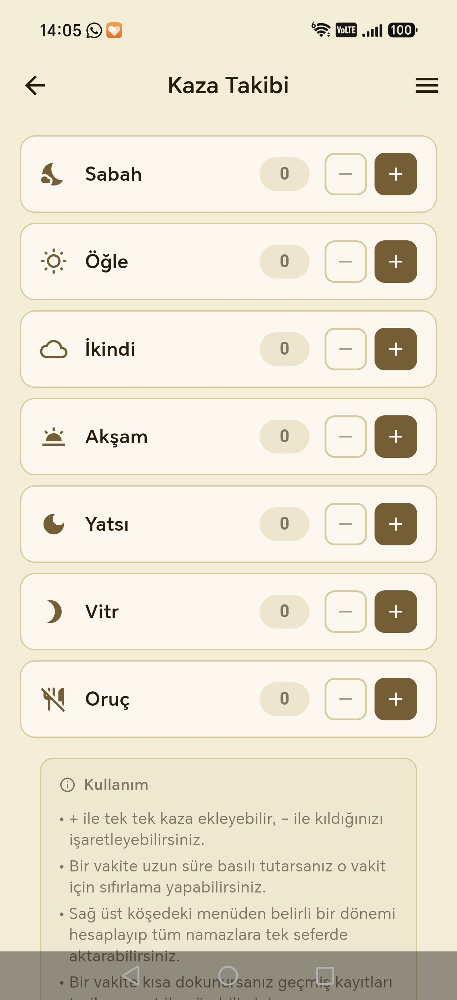
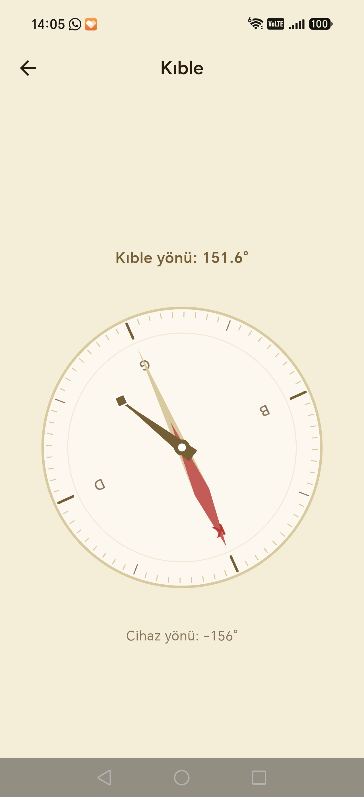
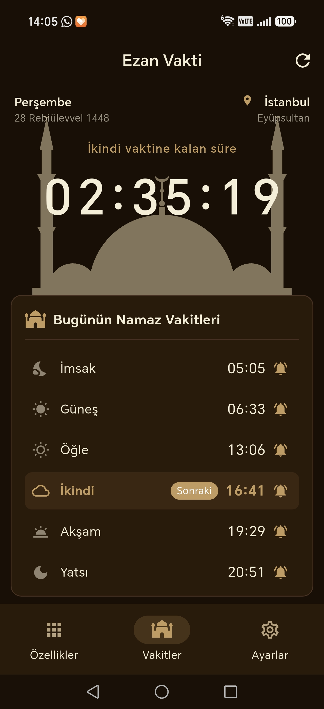
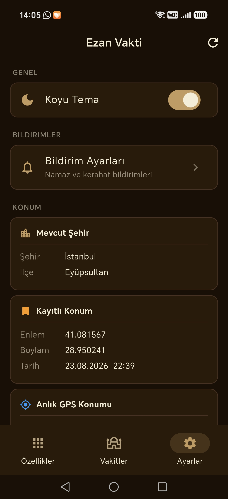

# Ezan Vakti

Türkiye'deki namaz vakitlerini takip etmek için geliştirilmiş Flutter uygulaması. Açık ve koyu tema desteği, ana ekran widget'ı ve çeşitli İslami araçlar içerir.

---

## Özellikler

### Namaz Vakitleri
- İmsak, Güneş, Öğle, İkindi, Akşam, Yatsı vakitlerini gösterir
- Şehre göre otomatik vakit hesaplama
- Şu anki aktif vakit vurgusu

### Ana Ekran Widget'ı
- 6 vakit tek bakışta görünür
- **Açık tema** ve **koyu tema** olmak üzere iki ayrı widget
- 2×2 boyutunda kompakt görünüm; büyütüldüğünde daha geniş ve okunaklı tasarım
- Aktif vakti renkli olarak vurgular
- Üzerindeki ↻ butonuyla anlık güncelleme
- Android 12+ için canlı widget önizlemesi

### Kıble
- Pusula ile Mekke yönünü gösterir
- Anlık yön takibi

### Zikirmatik
- Özel zikir oluşturma ve kaydetme
- Sayaç ile zikir takibi

### Kaza Takibi
- Kaza namazı ve oruç takibi
- Kaçan ibadetleri kayıt altında tutar

### Yakınımdaki Camiler
- 2 km çevresindeki camileri harita ve liste olarak gösterir
- Türkiye'deki camilerin (OpenStreetMap) listesi uygulamanın içinde gömülü: internet olmadan da anında açılır
- İnternet varsa güncel veri arka planda alınır; sonuçlar önbelleğe yazılır
- İsimli camiler listede önce gösterilir

### Kur'an-ı Kerim
- Medine mushafının 604 sayfası, sûre ve cüz listeleriyle
- Gerçek bir kitap gibi **sayfa çevirme efekti** (sırt sağda, mushaf yönünde)
- Arapça (mushaf görünümü) ve ayet ayet **Diyanet meali** görünümü
- Ayete dokununca Arapça, meal ve Diyanet Kur'an Portalı'nda tefsire bağlantı
- Kaldığın sayfayı hatırlar
- Üstteki **Aa** düğmesiyle 4 yazı tipi arasından seçim: Klasik nesih (Scheherazade New), Klasik matbaa (Amiri), Kur'an hattı (Amiri Quran), Sade nesih (Noto Naskh Arabic); seçim hatırlanır

### Dualar
- Kur'an ve hadislerden 36 dua: Arapça, okunuş, meal ve kaynak
- Meal ve künyeler Diyanet yayınlarından; arama ve ayet/hadis filtresi

### Dini Günler
- Diyanet'in resmî takvimine göre kandiller, bayramlar, arefe, Ramazan ve diğer dini günler
- Ana ekranda bugün/yarın bir dini gün varsa bilgi şeridi ("Yarın akşam Miraç Kandili", "Ramazan Bayramı'nın 2. günü")

### Bildirimler
- Namaz vakti bildirimleri
- Her vakit için ayrı ayrı açılıp kapatılabilir

### Güncelleme Kontrolü
- Açılışta GitHub'daki son sürüme bakar; yeni sürüm varsa indirme sayfasına yönlendirir

---

## Veri Dosyalarını Yenileme

Release öncesi çalıştırılır (proje kökünden):

```bash
python tools/build_mosque_data.py   # Türkiye cami listesi (OpenStreetMap)
python tools/build_dini_gunler.py   # Diyanet dini gün takvimi
```

Kur'an verisi (`assets/data/kuran.json`) `tools/build_quran_data.py` ile üretilir. Kur'an yazı tipleri: Scheherazade New, Amiri, Amiri Quran, Noto Naskh Arabic (hepsi SIL OFL; lisanslar `assets/fonts/`).

---

## Teknik Bilgiler

- **Framework:** Flutter
- **Platform:** Android (iOS desteği yakında)
- **Minimum Android:** API 24 (Android 7.0)
- **Widget:** home_widget paketi, `HomeWidgetProvider` tabanlı

---

## Kurulum

```bash
flutter pub get
flutter run
```

Widget'ı test etmek için release benzeri bir build gerekebilir:

```bash
flutter run --profile
```

---

## Ekran Görüntüleri

<table>
  <tr>
    <td></td>
    <td></td>
  </tr>
  <tr>
    <td></td>
    <td></td>
  </tr>
  <tr>
    <td></td>
    <td></td>
  </tr>
  <tr>
    <td></td>
    <td></td>
  </tr>
</table>

---

## Lisans

Bu proje kişisel kullanım amaçlıdır.
